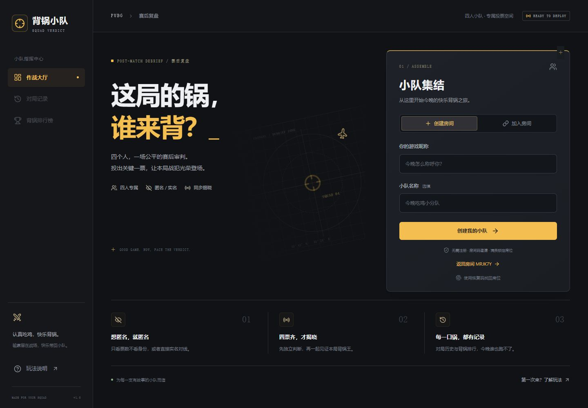
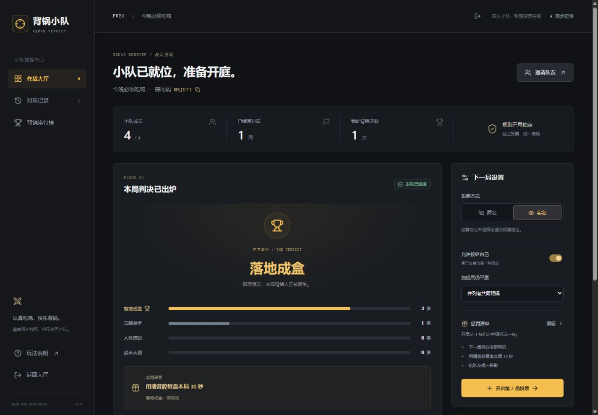
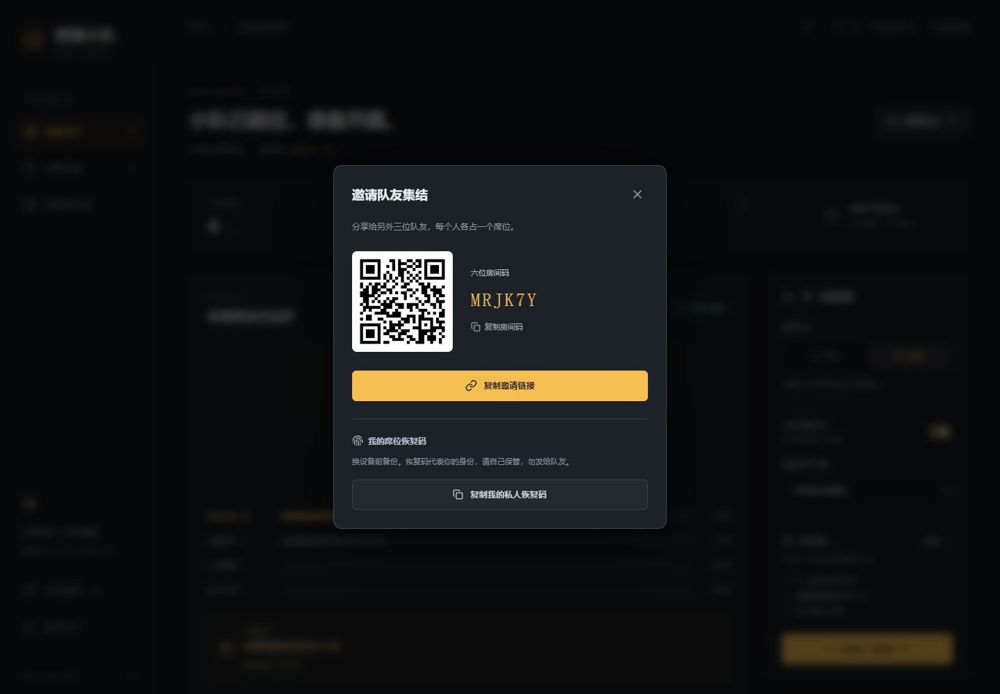

# PUBG Tribunal · 背锅小队

四个人的 PUBG 赛后投票系统。创建房间、邀请队友、匿名或实名投票，也可以选择弃票。四人提交后统一揭晓，全员弃票则本局无人背锅、无需惩罚。适配电脑与手机。

**[在线试用](https://squad-verdict-d5g9kqjfk96c42cc0-1507116553.ap-shanghai.app.tcloudbase.com/)** · [CloudBase 部署说明](docs/CLOUDBASE_DEPLOYMENT.md) · [架构与规则](docs/ARCHITECTURE.md) · [验证记录](docs/VERIFICATION.md)

> 在线地址使用腾讯云 CloudBase 测试域名，首次打开需在平台提示页点击“确定访问”。截至 2026-10-15，该环境使用免费体验版，有效至 2027-04-15，按量付费关闭。免费额度、续期和域名限制以腾讯云当时规则为准。



## 已实现

- 六位房间码、邀请链接和本地生成的邀请二维码。
- 四人席位；每个成员有独立凭证，刷新保留身份，也可备份恢复码换设备。
- 房主可通过“管理成员”踢人或转移房主；踢人后空位可补位，历史记录与离队成员排名保留。
- 成员可在房间顶部“修改昵称”，保留席位、恢复码、房主身份和历史统计；投票中暂不允许改名。
- 匿名与实名：结算后均公开理由。匿名展示被投队员和理由，隐藏提交者；实名展示投票者、目标和理由。
- 理由选填，支持预设标签与最多 80 字的自由输入（可换行）。首轮和加投分别展示，揭晓前保持隐藏。
- 每人每轮一票；是否允许自投可配置；开局后模式、规则和惩罚锁定。
- 首轮和加投均可弃票；弃票计入提交进度，不参与队员排名。全员弃票直接以“无人背锅”结束，不安排惩罚、不增加背锅次数。
- 投票中只显示提交总数；四票到齐由服务端原子结算。
- 战犯必须是唯一最高票且至少得 2 票。首轮两人各 2 票时加投一次，加投仍平票或无人达到 2 票则无战犯，不共同背锅或随机抽人。
- 自定义惩罚清单；开局抽取并向所有人展示；战犯可确认完成。
- 对局历史、匿名隐私延续、背锅排行榜；作废局不计统计、不揭示选票。
- 约每 1.2 秒同步，断线重连、前后台切换恢复，服务重启后记录仍保留。

CloudBase 版本为减少免费额度消耗，投票中每 3 秒、等待阶段每 20 秒同步，隐藏页面暂停轮询；队友开局最多可能延迟约 20 秒显示。



<details>
<summary>手机界面与邀请二维码</summary>

| 手机首页 | 手机结果 |
| --- | --- |
|  |  |



</details>

<details>
<summary>弃票与无人背锅</summary>

| 选择弃票 | 全员弃票结果 |
| --- | --- |
|  |  |

</details>

## 技术栈

React 19 + TypeScript，后端统一计票，通过数据库版本条件更新保证四人并发时不会丢票。界面、API 和 `lib/game.ts` 中的投票规则在两个部署目标间复用。

| 运行目标 | 网页与后端 | 数据保存 | 同步方式 |
| --- | --- | --- | --- |
| 本地 / Sites | Vinext + Cloudflare Worker | D1（SQLite）+ Drizzle 迁移 | 约 1.2 秒轮询 |
| 腾讯云 CloudBase | Vite 静态网页 + Node.js 普通云函数 | 文档数据库 | 投票中 3 秒、等待中 20 秒轮询 |

## 本地运行

需要 Node.js 22.13 或更高版本、npm 和 Git。推荐 Node.js 24。本地验证不需要腾讯云账号或密钥。

```powershell
git clone https://github.com/fan-xii/PUBG-Tribunal.git
cd PUBG-Tribunal
npm run install:ci
npm run build
npm run db:migrate
npm run dev
```

地址以终端输出为准，默认 http://127.0.0.1:5173 。

Windows 也可以一键启动：

```powershell
powershell -ExecutionPolicy Bypass -File .\scripts\dev.ps1
```

脚本会安装缺失依赖、构建、应用本地数据库迁移并启动服务。以后只需 `npm run dev`。修改数据库结构后执行 `npm run db:generate` 和 `npm run db:migrate`；第一次运行迁移前需要构建一次。

已构建的 Worker 可通过 `npm start -- --port 8787` 本地运行。开发预览和构建预览使用同一份 `.wrangler/state/` 本地持久化数据。

## 四个人怎么玩

1. 房主填昵称，创建房间，点击“邀请队友”复制链接或展示二维码。
2. 三位队友分别在自己的浏览器加入，各占一个席位。房间码链接只用于邀请，不包含任何人的私人凭证。
3. 房主选择匿名/实名、是否允许自投，并编辑惩罚清单。两票门槛与加投判定为固定规则。
4. 每局结束后开启投票。每人选择一个队员或弃票；投给队员时可点选理由标签或自由输入最多 80 字（支持换行），确认后不能改票。
5. 四人全部提交后揭晓。唯一最高票者至少得 2 票才当选，弃票不计入队员得票。首轮无人达到 2 票，只展示票数和理由；两人各 2 票时，四人对两名候选人加投一次，也可弃票。加投仍为 2:2 或无人达到 2 票，则无战犯、无需惩罚。
6. 当选者确认完成惩罚，房主开始下一局。历史和榜单自动累计。

| 票数示例 | 结果 |
| --- | --- |
| 首轮 1:1:1:1，或一票加三弃 | 无战犯，保留票数与理由 |
| 首轮 2:1:1，或两票加两弃 | 两票者当选 |
| 首轮 2:2 | 加投一次 |
| 加投 2:2，或 1:1 加两弃 | 无战犯，不执行惩罚 |
| 加投 2:1 加一弃，或 3:1 | 唯一最高票者当选 |

已开局的旧对局继续按开局时锁定的旧规则完成，历史结果不重新计算；更新后新开的对局使用两票门槛。

实名指游戏昵称，不要求真实姓名。新开匿名局在结算后公开被投队员及理由，不显示理由提交者，列表按内容排列；后续切换实名也不会公开历史匿名票的提交者。更新前的匿名局继续保密理由，不追溯公开。服务端数据库仍保存选票用于计票和防重；拥有云账号或数据库管理权限的人能够访问原始数据。四人也可能从措辞、聊天和票数推测身份。

房主在房间顶部点击“管理成员”，可将房主转移给其他现役队员，或在投票结束后踢出队员。投票与加投进行中不能踢人，可先结算或作废；转移房主不影响正在进行的投票，原房主立即降为普通成员。

被踢队员的旧凭证和恢复码立即失效，空位可由新队友加入。踢人保留历史姓名、票数、投票隐私与排行榜；这是移出席位，不是账号封禁，持有邀请链接的人仍可重新加入空位。房主不能踢出自己或将房主转移给自己。

换设备前，在邀请弹窗复制自己的私人恢复码，在首页“使用恢复码找回席位”中恢复。恢复码相当于席位钥匙，不要分享给别人。

改名无需退队：点击“修改昵称”，填写 1–12 个字符的新昵称，不能与当前队友重名（不区分大小写）。只修改自己在当前房间的名字；历史记录和排行榜也会显示新昵称，统计继续累计。首轮投票和加投期间不能改名，结算或作废后即可修改。


## 多人访问与部署

### 腾讯云 CloudBase

在线试用版已部署到腾讯云。自行部署时，需要使用自己的环境，创建 `squad_rooms` 文档集合并设为仅服务端可访问，再部署云函数、静态网页和同域名路由。

先安装主项目依赖，再构建 CloudBase 产物：

```powershell
npm ci --prefix deploy/cloudbase
node deploy/cloudbase/build.mjs
```

- `outputs/cloudbase/web/`：静态网页。
- `outputs/cloudbase/functions/squad-api/`：包含 Node SDK 的普通云函数，入口 `index.main`。

具体上传、路由、权限、免费额度和已部署环境信息见 [CloudBase 部署说明](docs/CLOUDBASE_DEPLOYMENT.md)。凭证保留在云平台或本机受保护的配置中，不能写入网页或提交到 Git。

### 本地与 Sites

本机 `127.0.0.1` 地址只供当前电脑验证。手机不能通过扫描一个 localhost 地址连接到这台电脑；四人异地使用需要一个所有人都能访问的公网 HTTPS 地址。

仓库保留 Sites 构建配置，`.openai/hosting.json` 中包含原站点的 Site ID 与 D1 绑定。自行部署时请配置自己的站点身份、数据库绑定和访问范围。Sites 的新站默认是私有预览；分享房间链接不会绕过站点本身的访问权限。房间成员身份校验始终由应用自身执行。

本地数据库与托管数据库彼此独立；本地测试房间不会随代码发布。`.wrangler/`、恢复码、环境文件不应进入源码仓库。备份本地数据时先停止服务，再保存整个 `.wrangler/state/` 目录。

## 验证

先启动服务，再运行：

```powershell
npm run typecheck
npm test
```

`npm test` 依次运行六份验证脚本，共 108 项检查。基础脚本以四份独立凭证调用真实接口，检查并发加入/投票、匿名防泄露、实名明细、重复票、规则锁定、两票判定与加投、惩罚确认、作废与权限等 33 项行为。

`tests/membership.mjs` 另含 14 项检查，覆盖管理权限、投票中转移、踢人后的凭证失效与补位、历史阵容保持、并发转移以及旧数据兼容。

`tests/abstention.mjs` 含 18 项检查，覆盖全员/部分弃票、加投弃票、匿名保密、实名明细、重复提交拦截、无人背锅时无惩罚及历史保存。

`tests/rename.mjs` 含 12 项检查，覆盖成员自己改名、输入与重名校验、并发改名、投票中限制、凭证与历史统计保留，以及被踢后禁止改名。

`tests/reasons.mjs` 含 13 项检查，覆盖多行文字、长度和非法输入、匿名理由投影、揭晓时机、首轮与加投、作废隐藏、旧数据兼容，以及与提交顺序无关的展示顺序。

`tests/verdict-threshold.mjs` 含 18 项检查，覆盖两轮的票数门槛、2:2 加投、分票与弃票、无战犯时无惩罚、四人读取一致、历史累计，以及旧局锁定规则兼容。

2026-10-16 已发布两票门槛规则，以及成员管理、弃票、修改昵称与自由理由功能；测试指向腾讯云后共 108 项通过（四项为本地纯逻辑检查，其余访问真实 API）。浏览器已验证四人各一票时无战犯、票数和理由保留，以及成员管理、全员弃票、保存昵称与匿名理由不标明提交者。测试会创建房间和对局数据，请优先使用自己的开发环境。

验证生产构建可在另一个 PowerShell 窗口中运行：

```powershell
npm start -- --port 8787
```

然后：

```powershell
$env:TEST_BASE_URL = 'http://127.0.0.1:8787'
node tests/verify.mjs --restart
```

脚本会在最后提示重启服务。停止并重新运行 `npm start -- --port 8787`，回到测试窗口按回车，会增加一项服务器重启后的持久化验证。测试身份只保存在进程内存中。

浏览器验证截图在 `docs/screenshots/`。代码结构、接口与隐私细节见 [架构说明](docs/ARCHITECTURE.md)。

## 主要文件

| 文件 | 职责 |
| --- | --- |
| `app/vote-app.tsx` | 大厅、房间、投票、结果、邀请、历史、排行及恢复界面 |
| `app/vote.css` | 深色战术界面与手机布局 |
| `app/api/rooms/` | 创建、加入、身份校验及投票接口 |
| `lib/game.ts` | 投票规则、平票流程、结果投影与匿名过滤 |
| `lib/room-store.ts` | D1 读写与乐观锁 |
| `lib/room-http.ts` | 凭证散列、请求校验与错误响应 |
| `deploy/cloudbase/` | CloudBase 网页入口、存储适配、网关入口及构建配置 |
| `db/schema.ts`、`drizzle/` | 数据库结构及迁移 |
| `tests/verify.mjs` | 四身份 HTTP 验证 |
| `scripts/dev.ps1` | Windows 一键启动 |

