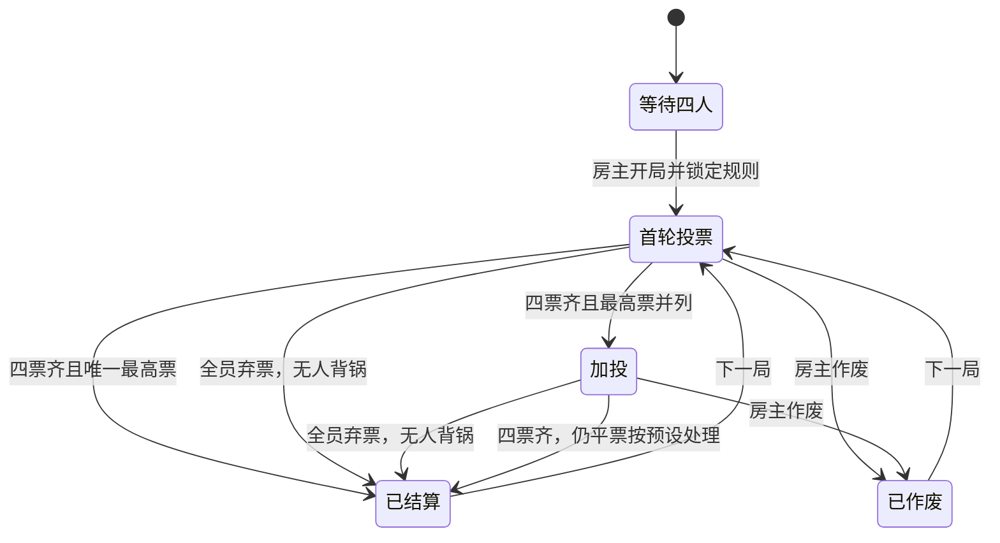

# 代码导览与规则

项目使用 React 19、TypeScript、Vinext、Cloudflare Worker 和 D1（SQLite）。为兼容直接在线部署，跨设备同步采用约 1.2 秒一次的串行轮询；没有使用 SignalR。页面隐藏时暂停请求，回来后恢复，写入后立即更新本地显示。

腾讯云部署目标复用相同界面、业务逻辑及 API，以 Vite 构建静态网页、普通 Node.js 云函数运行后端，并通过 `deploy/cloudbase/room-store.ts` 适配文档数据库。该版本投票中每 3 秒、等待中每 20 秒同步；完整路径与权限见 [CloudBase 部署说明](CLOUDBASE_DEPLOYMENT.md)。

## 请求与数据

- `POST /api/rooms`：创建房间，返回房主的私人凭证。
- `POST /api/rooms/:code`，`action=join`：加入房间，返回该成员的私人凭证。
- `GET /api/rooms/:code`：通过 `Authorization: Bearer <私人凭证>` 读取经过隐私过滤的房间。
- 同一 POST 接口通过 `action=start/vote/cancel/complete` 开局、投票（含弃票）、作废和确认惩罚，通过 `action=kick/transferHost` 踢人和转移房主。

房间码用于邀请，不是身份凭证。每个成员有两个 UUID 组成的随机凭证；服务器只保存 SHA-256 散列。接口根据凭证识别成员，不信任客户端传来的投票者身份。房主有开局、作废权限；确认惩罚只能由本人执行。

`lib/game.ts` 负责状态流转和输出投影。`lib/room-store.ts` 负责 D1 读写；`lib/room-http.ts` 提供凭证散列、请求校验和错误处理。`app/api/rooms/` 是 API；`app/vote-app.tsx` 和 `app/vote.css` 是交互和视觉。

## 原子计票

每个房间存为一行：`code / document / revision / updated_at`。所有写入先读取文档和版本，验证规则，再用 `UPDATE ... WHERE revision = ?` 原子提交。版本不匹配时重新读取并重新验证。最后一票与结算更新在同一条写入中完成，避免并发丢票、重复当选或重复加投。

## 弃票与无人背锅

投票请求使用 `targetId: null` 显式表示弃票；缺失、空字符串或非法目标仍按无效提交拒绝。弃票与普通选票一样占用本阶段的一次提交机会，服务端仍等待四人提交，不能改票或重复提交。

弃票不计入任何队员的得票数，也不作为平票候选项。四人全弃时最高有效票数为 0，直接结算 `phase=result`、`winners=[]`、`penalty=""`，不会进入全员零票加投或随机抽人。加投也支持相同处理；有有效票时沿用原计票和平票规则。

结果投影仅在揭晓后公开 `abstentionCount`，投票中只返回总提交数与当前成员自己的 `myAbstained`，不泄露其他人的弃票选择。实名明细保留 `targetId=null` 并显示为“弃票”；匿名明细继续隐藏。无人背锅局保留在历史中，显示“无需惩罚”，不增加成员当选次数。

## 成员管理与历史阵容

`action=kick` 和 `action=transferHost` 复用相同的版本条件更新。每次冲突重试均重新核对当前房主，避免旧房主的延迟请求覆盖新房主决定。踢人仅在没有进行中的投票或加投时允许；房主不能操作自己。

踢人从 `members` 移除目标，使旧 Token 立即无法匹配；`formerMembers` 仅保存离队成员的 ID、昵称、加入和移出时间，不保存凭证。客户端收到身份失效后删除该房间的失效本地凭证，避免不断尝试恢复已经被移出的席位。

每局以 `participantIds` 保存当时的四人阵容，历史计票始终使用该阵容。首次踢人前为旧数据补齐此字段；历史姓名通过现役与离队名单共同解析，新队员不会替代过去的候选人。新成员可以在有空位且没有进行中投票时补位。

一局只能加投一次，四人都需提交投票或弃票，加投候选人限于首轮最高票者。允许自投与否对两轮均生效。有效票仍平票时共同背锅，或使用安全随机数在并列人中抽取一人；全员弃票直接无人背锅。惩罚在开局时抽取并公开，有战犯才执行。每房间最多 500 局。

## 匿名的边界

投票期间，服务器只返回提交总数及读取者自己的选择；其他成员的投票关系和实时得票数不返回。加投时展示首轮汇总票数。匿名局结算和历史仅返回汇总，房主无额外读取权限，理由也不公开。作废局无论模式均不公开明细。实名局仅在最终结算后公开两轮明细。

匿名指队内匿名，并非对数据库管理员匿名。服务端仍需存储选票来计票及防重；四人小组也可能通过聊天和票数推测身份。

## 席位与恢复

凭证保存在浏览器 localStorage，可通过邀请弹窗复制 `房间码.私人凭证` 作为恢复码，换设备后在大厅恢复。分享链接与二维码仅含房间码，不含任何私人凭证。四个席位满员后不能直接加入；房主可在投票结束后踢人释放空位，也可转移房主。被踢凭证失效；清理浏览器数据前应保存仍有效的恢复码。

## 验证

`tests/verify.mjs` 用四套独立凭证运行真实 HTTP 流程，覆盖并发加入/投票、匿名与实名、模式锁定、防重复、自投限制、加投、共同/随机处理、作废、权限、惩罚完成、跨站提交及输入错误。`--restart` 会在结束前等待人工重启服务，凭证仅留在内存中，然后验证持久化。

`tests/ui-companions.mjs 房间码` 为本地浏览器测试提供另外三个独立成员。不要对真实游戏房间运行验收脚本。
