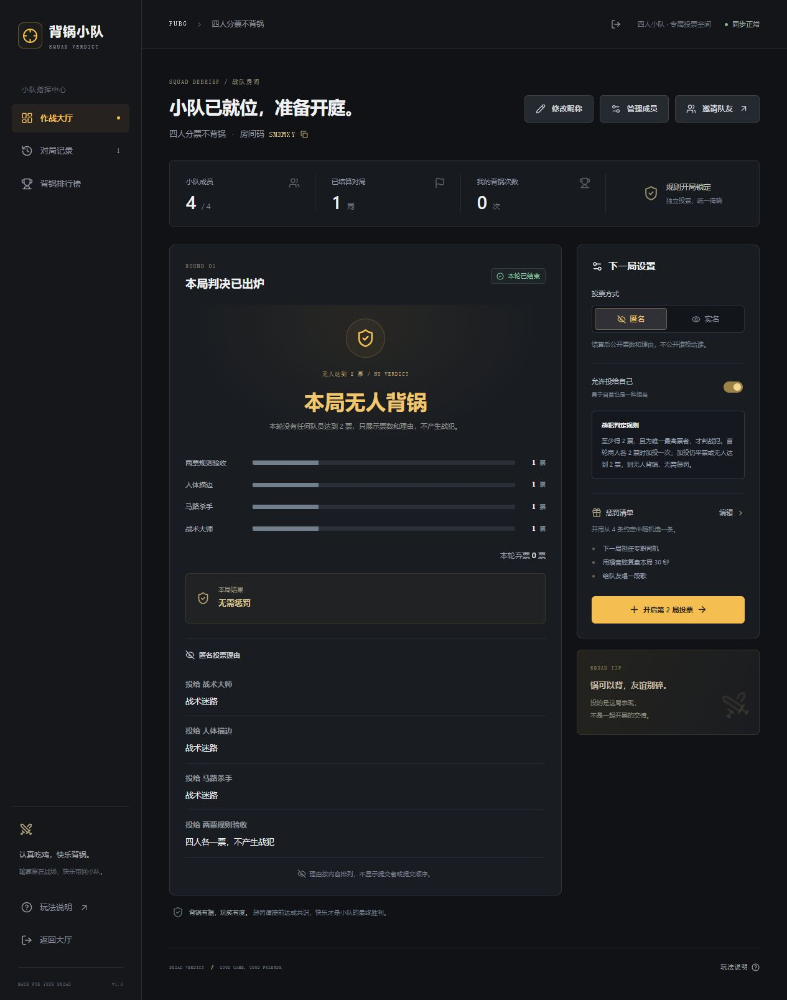

# CloudBase 免费版试用部署

目标：上海地域、免费体验环境；不购买资源包、不启用按量付费、不升级付费套餐。
账号资格、免费期限和额度必须在控制台再次确认。免费环境的续期不是自动的，默认域名也仅供开发测试。

## 当前进度

2026-10-16 已发布两票门槛规则，并保留成员管理、弃票、修改昵称与自由理由功能。普通云函数 `squad-api` 已更新到 `$LATEST`；网页版本 `squad-web-005`（buildId `2608786955`）部署成功。昵称修改保留席位、凭证、房主身份及历史统计，投票中禁止改名。新对局支持最多 80 字的多行理由，匿名局结算后公开理由但隐藏提交者，旧匿名局继续保密理由。新局唯一最高票且至少 2 票才判战犯，首轮 2:2 加投一次；加投仍平票或无人达到 2 票则无战犯。旧局按开局锁定规则完成，历史不重算。代码与文档已同步 GitHub。

- 已准备独立的 CloudBase 构建目标，复用网页、服务端校验和投票逻辑。
- 已构建静态网页和普通事件云函数；普通云函数使用平台临时凭证，不需要在前端或源码放置 AccessKey。
- 账号登录及实名认证已通过。创建页已选择上海、免费体验版、云数据库（JSON），环境名称 `squad-verdict`。
- 已验证官方免费兑换码并完成 0 元订单；未勾选付费搭售项目。
- 免费环境已创建：`squad-verdict-d5g9kqjfk96c42cc0`，上海，体验版，到期时间 `2027-04-15 23:59:59`。
- 已部署文档集合 `squad_rooms`，权限为 `ADMINONLY`，禁止客户端直接读写。
- 已部署普通云函数 `squad-api`，状态正常；Node.js 20.19、256 MB、3 秒、入口 `index.main`，未启用在线安装依赖或 API Key 注入。
- 已发布静态应用 `squad-web`（当前版本 `squad-web-005`），根路径 `/`；同域名 `/api` 路由指向 `squad-api`，开启路径透传。两条路由不启用跨域设置；房间权限由后端凭证验证。
- 实际访问地址：<https://squad-verdict-d5g9kqjfk96c42cc0-1507116553.ap-shanghai.app.tcloudbase.com/>。
- 已检查套餐页：免费体验版，3000 资源点/周期，按量付费开关关闭，体验版不支持自动续费；用量统计有更新延迟，页面暂时显示 0 不代表没有消耗。
- 未向本机 CLI 授权 CloudBase 全部资源权限；本次通过控制台上传代码包与网页包完成部署。

本地验证：CloudBase 静态网页和函数打包成功、TypeScript 检查通过；原 D1 接口回归 33 项通过；打包后的 CloudBase 网关适配器 6 项检查通过（路由、身份缺失、跨站拦截、非法 JSON、请求大小和禁止缓存，未访问腾讯云数据库）。
可上传压缩包：`outputs/cloudbase/web.zip`、`outputs/cloudbase/squad-api.zip`。

线上验证：设置 `TEST_BASE_URL` 为腾讯云实际地址后执行 `npm test`，基础 33 项、成员管理 14 项、弃票 18 项、修改昵称 12 项、理由 13 项、两票门槛 18 项，共 108 项通过。其中旧阵容、匿名理由排序、旧匿名理由保密及旧战犯规则兼容四项为本地纯逻辑检查，其余检查访问腾讯云实际 API。覆盖并发加入/投票、匿名与实名、平票加投、成员权限、凭证撤销、历史保存、弃票结算及改名。浏览器已完成全员弃票验收；已完成改名验收，当前网页脚本为 `index-CqQFq3ID.js`。

验收会创建独立测试房间；弃票与改名浏览器验收房间为 `NFR9JH`，自由理由验收为 `4A65K9`。新规则下四个独立身份提交后，结果展示多行理由及预设标签，隐藏提交者。浏览器错误记录为空。测试数据保留，正式使用请在大厅用自己的游戏昵称新建房间。


两票门槛浏览器验收房间 `SMKMXY`：四人各得 1 票，直接无战犯且无需惩罚，票数和匿名理由保留，房主可继续开局，浏览器错误记录为空。



## 本地构建

在项目根目录执行：

```powershell
npm ci --prefix deploy/cloudbase
node deploy/cloudbase/build.mjs
npm run typecheck
Compress-Archive -Path outputs/cloudbase/functions/squad-api/* -DestinationPath outputs/cloudbase/squad-api.zip -Force
Compress-Archive -Path outputs/cloudbase/web/* -DestinationPath outputs/cloudbase/web.zip -Force
```

构建产物位于 `outputs/cloudbase/web/` 和 `outputs/cloudbase/functions/squad-api/`。
静态产物不包含服务器凭证；函数包内已打包 Node SDK。

## 开通后配置

1. 使用经过实名认证的腾讯云账号确认免费体验资格；记录环境 ID、到期时间、每月额度和超额处理方式。
2. 在上海地域创建免费环境，创建文档数据库集合 `squad_rooms`。
3. 集合安全规则禁止客户端直接读写：`{"read":false,"write":false}`。完整选票和身份哈希仅由服务端 SDK 操作。
4. 创建普通事件云函数 `squad-api`，Node.js 20.19、256 MB、3 秒，入口 `index.main`，上传 `outputs/cloudbase/functions/squad-api/` 目录的内容。
5. 将 `outputs/cloudbase/web/` 的内容部署到静态托管。
6. 在同一个默认域名配置 `/` 指向静态托管、`/api` 指向云函数，并开启路径透传，使事件收到 `/api/rooms/...` 完整路径。
7. 网关调用需要允许游客抵达函数；房间数据访问仍由后端验证成员凭证。只调整投票函数的调用规则，不开放数据库。若控制台需要确认权限变更，展示具体配置后再执行。
8. 用四个独立身份验证创建/加入、并发投票、匿名与实名结果、跨站写入拦截及重新加载后的数据保存。

`deploy/cloudbase/cloudbaserc.example.json` 是函数配置参考，需替换环境 ID；不会自动创建环境、开通付费服务、修改网关鉴权或发布网页。

## 用量控制

仅 CloudBase 页面启用节省请求的轮询策略：投票中每 3 秒刷新，等待下一局每 20 秒刷新，隐藏页面不发送轮询请求。
等待阶段发现队友开局最多可能延迟约 20 秒。是否能长期留在免费额度内，需要依据实际晚间使用量和控制台统计判断。

## 官方说明

- [创建环境](https://docs.cloudbase.net/quick-start/create-env)
- [资源点价格](https://cloud.tencent.com/document/product/876/127357)
- [免费续期](https://cloudbase.cloud.tencent.com/blog/2026/07/28/cloudbase-free-trial-renewal)
- [默认域名限制](https://docs.cloudbase.net/service/alias)
- [普通函数通过 HTTP 网关访问](https://docs.cloudbase.net/service/access-cloud-function)

原 Sites 部署入口和数据库保持独立。腾讯云测试网址首次打开会展示平台提示页，点击“确定访问”后进入网页；默认域名只适用于开发测试，正式使用的域名与套餐要求以腾讯云规则为准。
