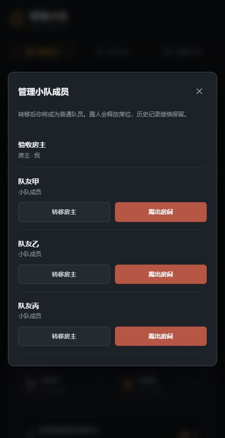
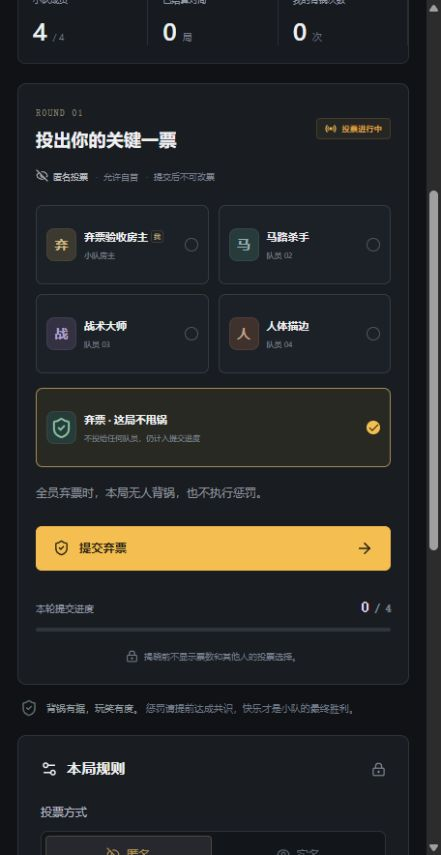
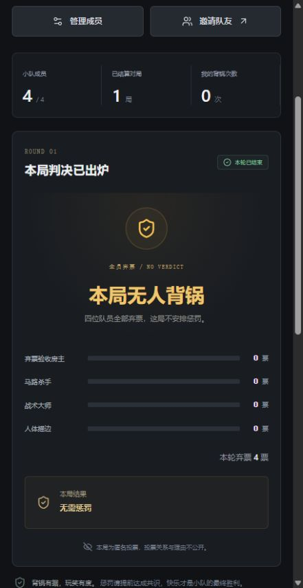
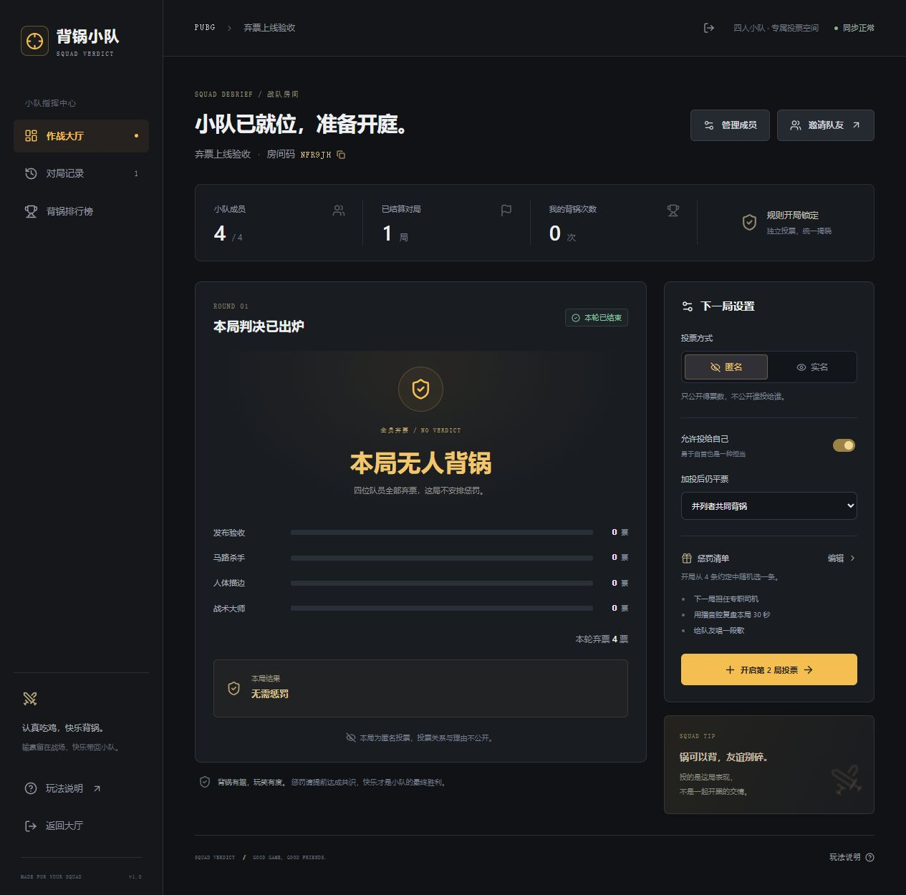
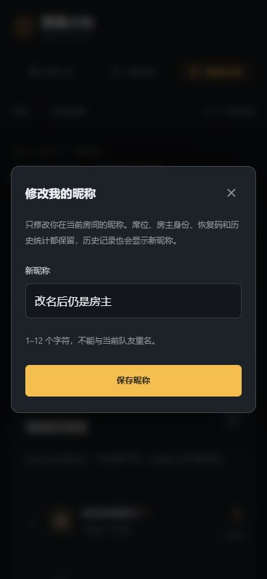
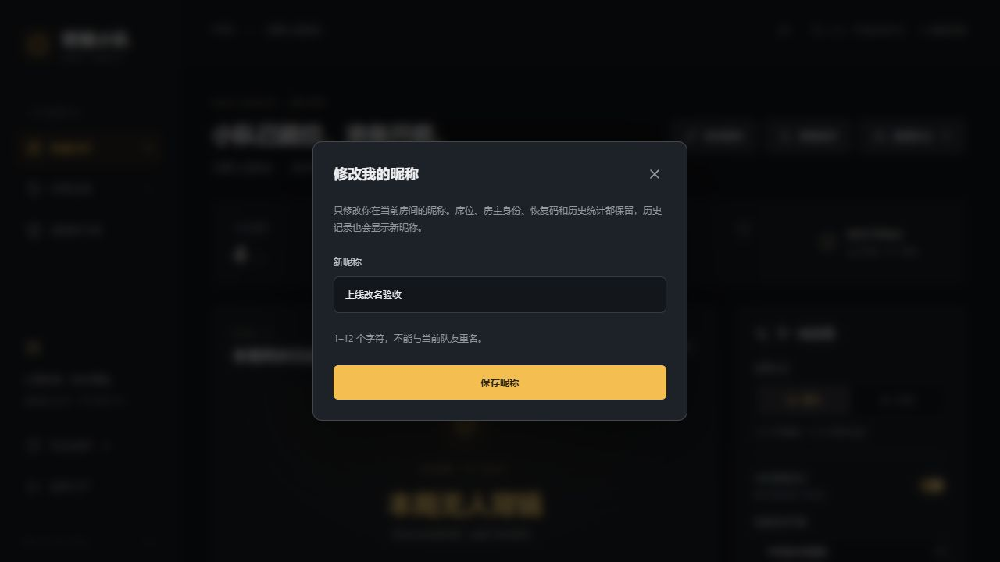
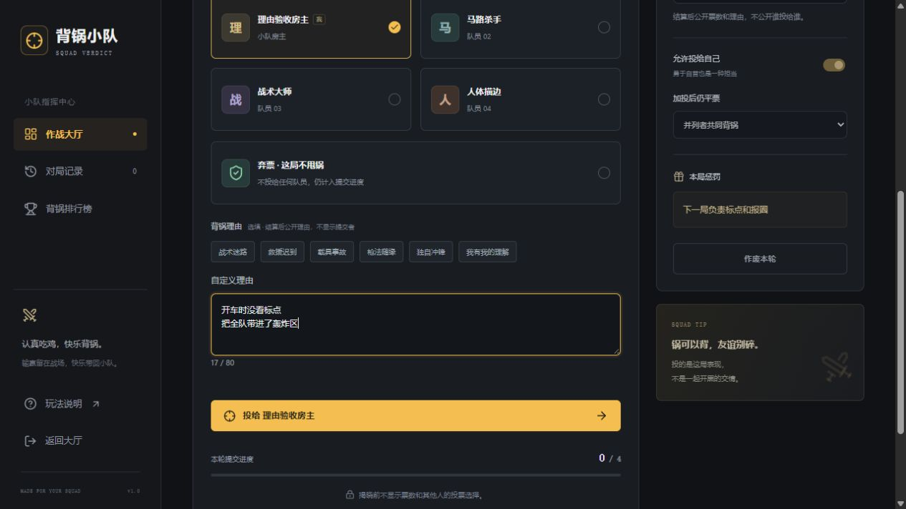
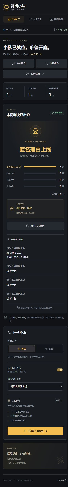
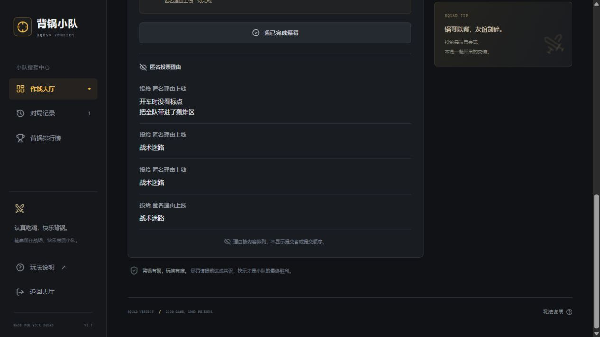

# 验证记录

验证日期：2026-10-15（北京时间）。

- `npm run typecheck`：通过，无 TypeScript 错误。
- `npm run build`：通过，生成浏览器资源和 Worker。
- 全新本地数据库应用迁移成功；第二次应用无待执行迁移。
- 开发服务上的四身份 HTTP 验证：33 passed, 0 failed。
- 生产构建 Worker 上的完整验证，包含停止服务后重新启动：34 passed, 0 failed。
- 浏览器实际操作：创建房间、另外三名独立成员加入、实名投票、确认、自动揭晓、惩罚完成、邀请二维码、复制邀请/恢复码、恢复原席位、历史和排行榜均已检查。
- 1440 × 1000 桌面、390 × 844 手机、320 × 740 窄手机布局已检查。两个手机宽度的内容宽度分别为 375、305 像素，没有横向溢出。
- 浏览器控制台未发现错误。

截图见 `docs/screenshots/`。所有示例昵称和对局均为测试数据，本地数据不会打包到托管站点。此记录描述本地及生产构建预览验证，不代表完成了四台实体设备或公网链路测试。

## 成员管理更新验证（2026-10-15）

- TypeScript 检查、CloudBase 网页与函数构建通过。
- 原接口验证 33 项通过，新增 `tests/membership.mjs` 14 项通过，`npm test` 包含两份脚本。
- 新增检查包含普通成员越权、自操作、进行中禁止踢人、投票中转移及旧房主权限立即失效、凭证撤销、补位、历史阵容不变、并发转移和旧数据兼容。
- 浏览器在独立本地验收房间验证了踢出确认、空位释放、转移确认，以及转移后原房主的管理与开局入口消失。
- 已发布到腾讯云；针对实际 API 的成员管理验证通过，线上网页可打开成员管理弹窗。

## 弃票更新验证（2026-10-15）

- `npm test`：基础 33 项、成员管理 14 项、弃票 18 项，共 65 项通过；TypeScript、Worker 和 CloudBase 构建通过。
- 弃票验证覆盖显式空目标、不可自投时弃票、揭晓前隐私、重复/延迟请求、并发全弃、部分有效票、加投全弃、实名两轮明细、无惩罚及历史读取。
- 浏览器验证：四人测试房间选择并确认弃票，另外三名独立成员提交弃票，自动显示“本局无人背锅”和“无需惩罚”。历史标签正确，四名成员排行榜均为 0 次，浏览器未记录错误。
- 已发布到腾讯云；针对实际 API 的弃票验证通过。线上浏览器房间 `NFR9JH` 已以四个独立身份完成全员弃票，正确显示“本局无人背锅 / 无需惩罚”，浏览器错误记录为空。

## 统一发布验收（2026-10-15）

- 云函数 squad-api 更新至 $LATEST；网页 squad-web-002（buildId 2608712343）部署成功。
- TEST_BASE_URL 指向腾讯云后运行 npm test：65 项通过，其中旧数据兼容项为本地纯逻辑检查，其余为真实云端接口检查。
- 浏览器加载脚本 index-BdHcYcQj.js，确认成员管理、弃票提交和全员弃票结算界面。
- 套餐仍为免费体验版，按量付费关闭；未购买资源或升级套餐。

## 修改昵称验证（2026-10-15）

- TypeScript、Worker 和 CloudBase 构建通过。
- 新增 `tests/rename.mjs` 共 12 项：身份与越权、昵称合法性、重名及并发竞争、房主与普通成员改名、首轮/加投限制、作废后改名、凭证与历史统计保留，以及被踢成员禁止改名。
- `TEST_BASE_URL` 指向腾讯云后执行 `npm test`，基础 33 + 成员管理 14 + 弃票 18 + 改名 12，共 77 项通过；其中旧数据兼容项为本地纯逻辑检查，其余访问实际云端 API。
- 本地浏览器确认重名提示、保存后历史和排行榜使用新昵称、房主仍可开局，以及投票中输入框与保存按钮禁用。390 × 844 手机宽度无横向溢出，浏览器错误记录为空。
- 已更新云函数与网页 `squad-web-003`（buildId `2608716928`），控制台显示部署成功；线上脚本为 `index-Bw8w8nuo.js`。浏览器在 `NFR9JH` 房间保存“上线改名验收”，已结算对局保持 1 局、房主管理及开局入口保留，再次打开弹窗显示新昵称，浏览器错误记录为空。

## 自由理由与匿名公开验证（2026-10-15）

- TypeScript、Worker 与 CloudBase 构建通过。
- 本地和指向腾讯云实际 API 的 `npm test` 各 90 项通过：基础 33、成员管理 14、弃票 18、改名 12、理由 13。三项为本地纯逻辑检查（旧阵容兼容、匿名理由顺序、旧匿名理由保密），其余访问真实接口。
- 新增检查覆盖 80 字边界、多行和 HTML 普通文字、非法输入、结算前及加投中隐藏、匿名投影仅含目标和理由、四人读取一致、重复理由、实名兼容、作废隐藏和历史保密。
- 本地浏览器房间 `WPJKPY`：点选标签可填入输入框，随后自由编辑为两行文字，确认弹窗完整显示；四个独立身份提交后，匿名结果出现自定义文字与标签理由，只显示被投队员，不显示理由提交者。浏览器错误记录为空。
- 手机布局验收时发现顶部三枚按钮挤压，已改为自然换行布局。
- 云函数与网页 `squad-web-004`（buildId `2608719851`）发布完成，控制台状态成功，线上脚本为 `index-BQ9_O-wo.js`。线上房间 `4A65K9` 经四个独立身份提交，正确展示两行自由理由与三个标签理由，不显示来源；浏览器错误记录为空。
- 线上 390 × 844 手机布局复验：文档可视宽度与内容宽度均为 375 像素，无横向溢出，三个操作按钮自然分为两行。

